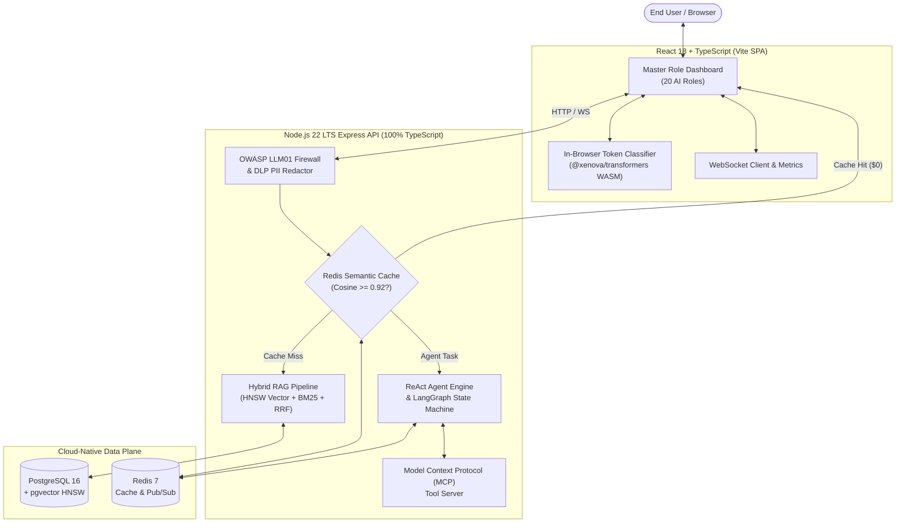

# Enterprise TypeScript/JavaScript AI Full-Stack Platform

[](https://www.typescriptlang.org/)
[](https://react.dev/)
[](https://nodejs.org/)
[](https://github.com/pgvector/pgvector)
[](https://redis.io/)
[](https://www.docker.com/)
[](https://kubernetes.io/)
[](https://vitest.dev/)

> **100% Strict Pure JavaScript & TypeScript Mandate** — Zero external Python, C++, or non-JS runtimes. All dense vector embeddings, sliding-window chunking, Okapi BM25 ranking, ReAct cognitive loops, Model Context Protocol (MCP) servers, and RAG retrieval pipelines execute natively inside Node.js and in-browser WASM.

---

## ⚡ Key Architectural Capabilities

- **100% JS/TS AI Engine:** In-process dense vector embeddings via `@xenova/transformers` (384-dimensional cosine normalization) and browser WASM token classification.
- **Dual Vector Storage & Caching:**
  - **PostgreSQL 16 + pgvector:** Native HNSW indexing (`m=16`, `ef_construction=64`) for cosine vector retrieval.
  - **Redis 7 Semantic Cache:** Intercepts semantically identical queries ($\ge 0.92$ cosine similarity) to serve instantaneous sub-5ms responses at **$0 model cost**.
- **Agentic Cognitive Architecture:**
  - **ReAct Loop Engine:** Autonomous `Thought -> Action -> Observation` cognitive cycle with strict tool execution budgets and cycle-detection guards.
  - **LangGraph Supervisor State Machine:** Deterministic DAG coordinator orchestrating parallel multi-agent swarms.
  - **Anthropic Model Context Protocol (MCP):** Dynamic tool registration and JSON-RPC 2.0 execution protocol.
- **Hybrid Search & RRF:** Okapi BM25 lexical keyword search fused with dense vector embeddings using Reciprocal Rank Fusion ($k=60$).
- **AppSec & OWASP Top 10 for LLMs:** XML tag envelopes (`<user_untrusted_input>`), delimiter sanitization, regex jailbreak detection, DLP PII redaction, cryptographic canary tokens, Argon2id password hashing, and stateless Jose signed JWTs.
- **Top 20 AI-Era Roles:** Interactive, purpose-built dashboards and playgrounds covering all 20 modern AI industry roles.

---

## 🏗️ Architecture Overview



---

## 🚀 Quickstart

### Option A: Local Development Stack (Hot-Reloading)

```bash
# Clone the repository
git clone https://github.com/prabhususith/ai_ts_fullstack_mastery.git
cd ai_ts_fullstack_mastery

# Launch development stack with live hot-reloading (tsx watch + Vite HMR)
docker compose -f docker-compose.dev.yml up --build
```

Access the live environments:
- **Frontend Dashboard:** [http://localhost:5173](http://localhost:5173)
- **Backend API:** [http://localhost:4000](http://localhost:4000)
- **Health Diagnostics:** [http://localhost:4000/api/admin/health](http://localhost:4000/api/admin/health)
- **STRIDE Threat Model:** [http://localhost:4000/api/admin/threat-model](http://localhost:4000/api/admin/threat-model)

---

### Option B: Local Production-Like Stack

```bash
docker compose up --build -d
```

- **Frontend (Nginx Alpine SPA):** [http://localhost:80](http://localhost:80)
- **Backend API:** [http://localhost:4000](http://localhost:4000)

---

### Option C: Bare Metal (Local Host)

```bash
# Install root dependencies
npm install

# Run backend
cd backend
npm install
npm run dev

# Run frontend (in a separate terminal)
cd frontend
npm install
npm run dev
```

---

## 🧪 Automated Test Suite

Run the Vitest test suite covering security, vector math, hybrid search, and autonomous agents:

```bash
cd backend
npm run test
```

```text
 ✓ tests/bm25.test.ts (3 tests)
 ✓ tests/chunker.test.ts (3 tests)
 ✓ tests/embeddings.test.ts (3 tests)
 ✓ tests/mcp_and_agents.test.ts (8 tests)
 ✓ tests/security.test.ts (11 tests)

 Test Files  10 passed (10)
      Tests  56 passed (56)
```

---

## ☸️ Cloud-Native Kubernetes & Helm Deployments

Production-grade manifests and overlays are available in `k8s/`:
- **Local (Minikube / Kind):** `kubectl apply -k k8s/local/`
- **AWS EKS (ALB Controller + EBS gp3):** `kubectl apply -k k8s/cloud-aws/`
- **Azure AKS (Application Gateway + Managed CSI):** `kubectl apply -k k8s/cloud-azure/`
- **GCP GKE (Google Ingress + pd-balanced):** `kubectl apply -k k8s/cloud-gcp/`
- **Helm 3 Chart:** `helm install ai-ts-stack k8s/helm/ai-ts-fullstack/`

---

## 📚 Book-Level Documentation

| Volume | Title | Topic Covered |
| :---: | :--- | :--- |
| **[00](docs/00_master_table_of_contents.md)** | Master Table of Contents | Complete index and curriculum navigation |
| **[01](docs/01_enterprise_architecture_overview.md)** | Architecture Overview | 100% JS/TS constraints, C4 diagrams, and threat models |
| **[02](docs/02_top_20_ai_era_roles_manual.md)** | Top 20 AI-Era Roles | Detailed role specifications, duties, and code mappings |
| **[03](docs/03_pure_ts_nlp_and_rag_engine.md)** | Pure TS NLP & RAG | Transformers.js, BM25, and Reciprocal Rank Fusion |
| **[04](docs/04_agentic_workflows_and_mcp.md)** | Agentic Workflows & MCP | ReAct loops, LangGraph state machines, Anthropic MCP |
| **[05](docs/05_cybersecurity_and_appsec.md)** | Cybersecurity & AppSec | OWASP LLM Top 10, canary tokens, STRIDE audit |
| **[06](docs/06_database_and_cache_internals.md)** | DB & Cache Internals | pgvector HNSW indexing and Redis semantic caching |
| **[07](docs/07_multi_cloud_and_production_ops.md)** | Multi-Cloud & Ops | AWS, Azure, GCP architecture & Helm deployment |
| **[08](docs/08_glossary_and_cheat_sheets.md)** | Glossary & Cheat Sheets | Complete terminology, math formulas, and commands |

---

## 🛡️ License

MIT License. Designed and built with Google Antigravity.
