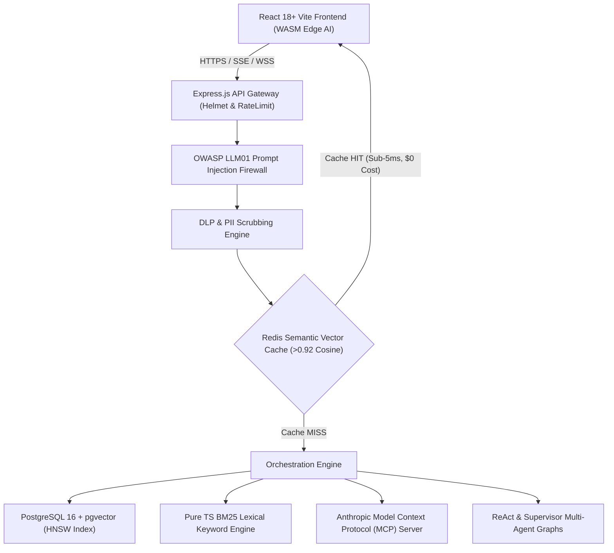
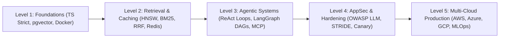

# Enterprise TypeScript/JavaScript AI Full-Stack Mastery: Book-Level Handbook & Specification

**Author:** Principal Polyglot AI Systems Architect & Lead TypeScript Engineer  
**Ecosystem Runtime:** Node.js 22 LTS | React 18+ | PostgreSQL 16 pgvector | Redis 7 | Anthropic MCP  
**Standard:** 100% Strict TypeScript Mandate (Zero Python / Zero C++ Runtime Dependencies)

---

## Executive Overview

This masterclass documentation suite provides exhaustive, book-level architectural coverage of the modern enterprise AI stack built purely on JavaScript and TypeScript. Every layer—from sliding-window semantic chunking and dense vector indexing with PostgreSQL `pgvector`, to Model Context Protocol (MCP) servers, ReAct autonomous loops, Redis semantic caching (>0.92 cosine), and OWASP Top 10 for LLMs defenses—is systematically specified, proven, and operationalized.

---

## Master Table of Contents

| Volume | Title | Core Focus & Artifacts |
| :--- | :--- | :--- |
| **[00](file:///p:/prabhu/projects/ai_ts_fullstack_mastery/docs/00_master_table_of_contents.md)** | **Master Table of Contents & Syllabus** | Curriculum index, architectural overview, and navigation map. |
| **[01](file:///p:/prabhu/projects/ai_ts_fullstack_mastery/docs/01_system_architecture_and_flow.md)** | **System Architecture & End-to-End Flow** | Monorepo layout, request lifecycle, dataflow pipelines, and Mermaid diagrams. |
| **[02](file:///p:/prabhu/projects/ai_ts_fullstack_mastery/docs/02_top_20_ai_era_roles_manual.md)** | **Top 20 AI-Era Roles Manual** | Detailed curriculum mapping 20 modern AI industry roles with TypeScript code. |
| **[03](file:///p:/prabhu/projects/ai_ts_fullstack_mastery/docs/03_rag_and_vector_db_deep_dive.md)** | **RAG & Vector DB Deep Dive** | pgvector internals, HNSW vs IVFFlat graphs, BM25, and Reciprocal Rank Fusion (RRF). |
| **[04](file:///p:/prabhu/projects/ai_ts_fullstack_mastery/docs/04_model_context_protocol_mcp.md)** | **Model Context Protocol (MCP) Manual** | Anthropic `@modelcontextprotocol/sdk`, JSON-RPC 2.0 specifications, and secure sandboxing. |
| **[05](file:///p:/prabhu/projects/ai_ts_fullstack_mastery/docs/05_autonomous_agentic_systems.md)** | **Autonomous Agentic Systems** | Pure TS ReAct cognitive loops, LangGraph state machines, and Swarm Supervisors. |
| **[06](file:///p:/prabhu/projects/ai_ts_fullstack_mastery/docs/06_cybersecurity_appsec_llm.md)** | **Cybersecurity & AI AppSec Defense** | OWASP Top 10 for LLMs, XML envelopes, canary tokens, Argon2id, and STRIDE matrices. |
| **[07](file:///p:/prabhu/projects/ai_ts_fullstack_mastery/docs/07_multi_cloud_deployment_guide.md)** | **Multi-Cloud Deployment Manual** | Infrastructure-as-Code for Localhost, AWS (ECS/RDS), Azure (ACA), and GCP (Cloud Run). |
| **[08](file:///p:/prabhu/projects/ai_ts_fullstack_mastery/docs/08_glossary_and_cheat_sheets.md)** | **Glossary, Formulas & Cheat Sheets** | Mathematical formulas, NPM catalogs, CLI cheat sheets, and algorithmic proofs. |
| **[09](file:///p:/prabhu/projects/ai_ts_fullstack_mastery/docs/09_emergent_ai_roles_multimodal_governance.md)** | **Emergent AI-Era Roles (Roles #21 - #25)** | Multimodal RAG, Human-in-the-Loop DPO, AI Evals Regression, EU AI Act & Speech AI. |

---

## Pedagogical Progression

