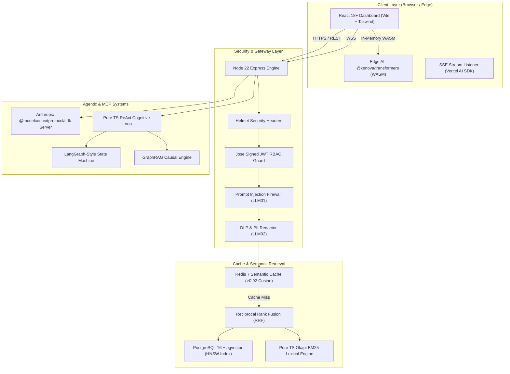
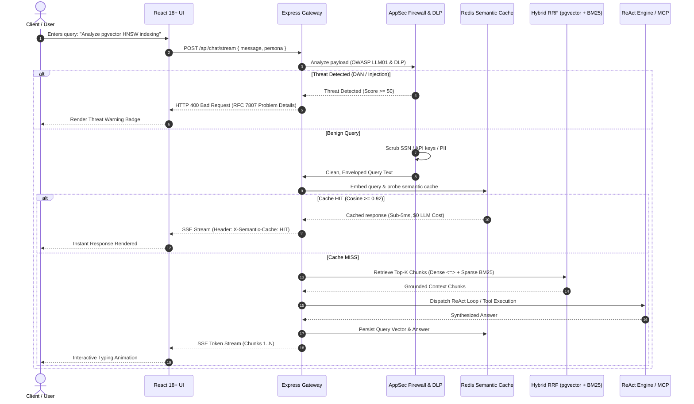

# Volume 01: System Architecture & End-to-End Flow

**Author:** Principal Polyglot AI Systems Architect & Lead TypeScript Engineer  
**Scope:** Distributed Monorepo Topology, Request Lifecycles, and Multi-Agent Orchestration

---

## 1. Architectural Blueprint & Component Topology

The enterprise AI system is engineered under a strict **100% JavaScript/TypeScript mandate**. Unlike legacy stacks requiring heterogeneous Python microservices for NLP or embeddings, every layer of this architecture runs directly on Node.js 22 LTS (backend) and React 18+ (frontend).

---

## 2. End-to-End Query & Stream Execution Sequence

The sequence diagram below models the complete lifecycle of a streaming query—including prompt injection screening, PII sanitization, semantic vector caching interception, and SSE token streaming.

---

## 3. The 100% JS/TS Advantage

1. **Unified Type System:** A single schema definition language (Zod) validates API boundaries, database persistence (Drizzle ORM), MCP tool inputs, and React UI form components.
2. **Zero Inter-Process Serialization Latency:** Eliminates fragile microservice bridges between Python backends (FastAPI) and Node.js servers. Embeddings and chunking occur in-memory within the V8 process.
3. **Deterministic Deployment:** A single `package.json` installs all dependencies natively via npm, eradicating Python virtual environments (`venv`, `poetry`, `conda`) and complex cross-platform compilation bugs.
