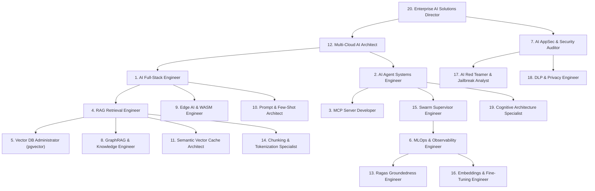
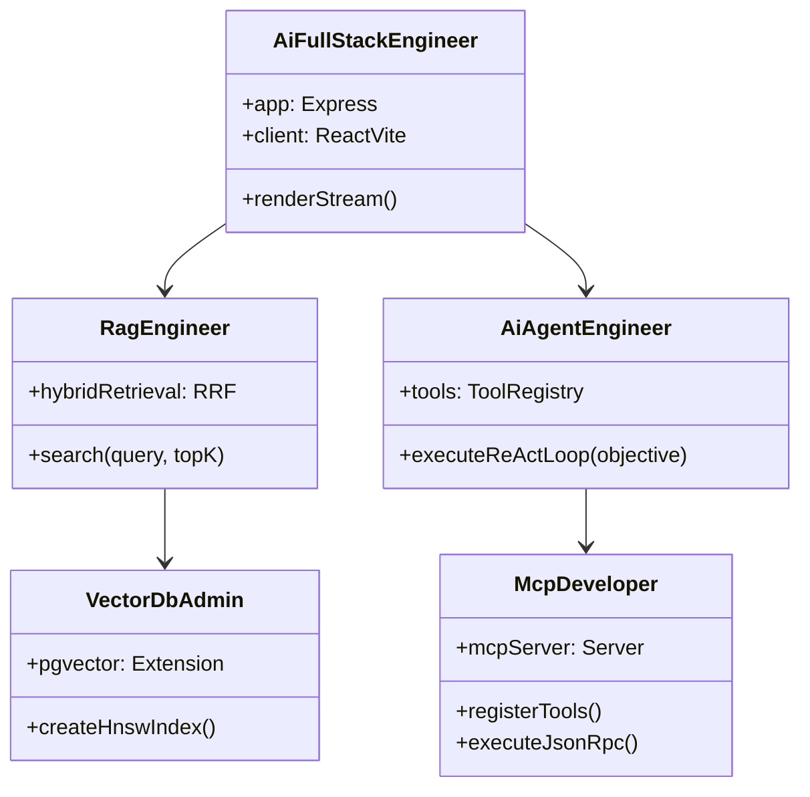

# Volume 02: Top 20 AI-Era Roles Manual & Engineering Handbook

**Author:** Principal Polyglot AI Systems Architect & Lead TypeScript Engineer  
**Objective:** Comprehensive architectural guide mapping all 20 specialized AI-era engineering roles directly to production TypeScript code modules.

---

## 1. Industry Role Taxonomy & Swarm Collaboration

---

## 2. Exhaustive Role-to-Code Mapping & Specifications

### Detailed Breakdown of the 20 Roles

#### 1. AI Full-Stack Engineer
- **Domain:** Bridging interactive streaming UIs with low-latency backend token inference.
- **Key TypeScript File:** [`backend/src/app.ts`](file:///p:/prabhu/projects/ai_ts_fullstack_mastery/backend/src/app.ts) & [`frontend/src/App.tsx`](file:///p:/prabhu/projects/ai_ts_fullstack_mastery/frontend/src/App.tsx)
- **NPM Stack:** `express`, `react`, `vite`, `tailwindcss`
- **Core Architecture:** Manages Server-Sent Events (SSE) connections, RFC 7807 problem details, and state synchronization.

#### 2. AI Agent Systems Engineer
- **Domain:** Autonomous cognitive cycles, tool binding, and multi-step action planning.
- **Key TypeScript File:** [`backend/src/ai/agents/reactAgentEngine.ts`](file:///p:/prabhu/projects/ai_ts_fullstack_mastery/backend/src/ai/agents/reactAgentEngine.ts)
- **NPM Stack:** `zod`, `ws`
- **Core Architecture:** Formulates Thought $\rightarrow$ Action $\rightarrow$ Observation iterations bounded by maximum execution thresholds.

#### 3. MCP Server Developer
- **Domain:** Model Context Protocol JSON-RPC tool endpoints and resource sharing.
- **Key TypeScript File:** [`backend/src/ai/mcp/enterpriseMcpServer.ts`](file:///p:/prabhu/projects/ai_ts_fullstack_mastery/backend/src/ai/mcp/enterpriseMcpServer.ts)
- **NPM Stack:** `@modelcontextprotocol/sdk`
- **Core Architecture:** Exposes tools (`execute_vector_search`, `calculate_semantic_similarity`, `execute_security_audit`) with strict JSON schemas.

#### 4. RAG Retrieval Engineer
- **Domain:** Hybrid search combining lexical BM25 and dense cosine distance via Reciprocal Rank Fusion (RRF).
- **Key TypeScript File:** [`backend/src/ai/rag/hybridRetrieval.ts`](file:///p:/prabhu/projects/ai_ts_fullstack_mastery/backend/src/ai/rag/hybridRetrieval.ts)
- **NPM Stack:** `pgvector`, `pg`
- **Core Architecture:** Formula $RRF\_Score(d) = \sum \frac{w_m}{k + r_m(d)}$.

#### 5. Vector Database Administrator (pgvector)
- **Domain:** PostgreSQL 16 vector extensions, HNSW graphs, and schema migrations.
- **Key TypeScript File:** [`backend/src/db/migrations/0001_vector_and_hnsw.sql`](file:///p:/prabhu/projects/ai_ts_fullstack_mastery/backend/src/db/migrations/0001_vector_and_hnsw.sql)
- **NPM Stack:** `pg`, `pgvector`, `drizzle-orm`
- **Core Architecture:** Tunes `m = 16`, `ef_construction = 64` on cosine distance `<=>`.

#### 6. MLOps & Observability Engineer
- **Domain:** Distributed tracing, execution latency tracking, and token cost economics.
- **Key TypeScript File:** [`backend/src/ai/mlops/tracingEvaluator.ts`](file:///p:/prabhu/projects/ai_ts_fullstack_mastery/backend/src/ai/mlops/tracingEvaluator.ts)
- **NPM Stack:** `ioredis`
- **Core Architecture:** Calculates input/output token costs across GPT-4o, Claude 3.5 Sonnet, Gemini 1.5 Pro, and local edge models.

#### 7. AI Application Security (AppSec) Engineer
- **Domain:** OWASP Top 10 for LLMs compliance and STRIDE threat modeling.
- **Key TypeScript File:** [`backend/src/security/threatModelAudit.ts`](file:///p:/prabhu/projects/ai_ts_fullstack_mastery/backend/src/security/threatModelAudit.ts)
- **NPM Stack:** `helmet`, `jose`
- **Core Architecture:** Audits Spoofing, Tampering, Repudiation, Information Disclosure, Denial of Service, and Elevation of Privilege.

#### 8. GraphRAG & Knowledge Engineer
- **Domain:** Semantic entity extraction, knowledge graph adjacency networks, and multi-hop causal reasoning.
- **Key TypeScript File:** [`backend/src/ai/graph/graphRagEngine.ts`](file:///p:/prabhu/projects/ai_ts_fullstack_mastery/backend/src/ai/graph/graphRagEngine.ts)
- **NPM Stack:** `zod`
- **Core Architecture:** Traverses 3-hop associative chains to recover indirect dependencies that dense vector search misses.

#### 9. Edge AI & WASM Engineer
- **Domain:** In-browser client inference via WebAssembly and ONNX runtimes.
- **Key TypeScript File:** [`frontend/src/ai/clientInference.ts`](file:///p:/prabhu/projects/ai_ts_fullstack_mastery/frontend/src/ai/clientInference.ts)
- **NPM Stack:** `@xenova/transformers`
- **Core Architecture:** Executes DistilBERT / MiniLM pipelines entirely on client hardware with 0 API cost.

#### 10. Prompt & Few-Shot Architect
- **Domain:** Parameterized few-shot prompt templates enforcing strict JSON output schemas.
- **Key TypeScript File:** [`backend/src/ai/prompts/templateRegistry.ts`](file:///p:/prabhu/projects/ai_ts_fullstack_mastery/backend/src/ai/prompts/templateRegistry.ts)
- **NPM Stack:** `zod`
- **Core Architecture:** Binds static types to LLM JSON generation contracts.

#### 11. Semantic Vector Cache Architect
- **Domain:** In-memory vector caching to eliminate redundant LLM calls.
- **Key TypeScript File:** [`backend/src/cache/semanticCacheRedis.ts`](file:///p:/prabhu/projects/ai_ts_fullstack_mastery/backend/src/cache/semanticCacheRedis.ts)
- **NPM Stack:** `ioredis`
- **Core Architecture:** Intercepts incoming queries with cosine similarity $\ge 0.92$ to deliver sub-5ms responses at \$0 cost.

#### 12. Multi-Cloud AI Architect
- **Domain:** Cloud-agnostic deployment manifests across AWS, Azure, GCP, and Localhost.
- **Key TypeScript File:** [`backend/src/config/cloudDeployConfig.ts`](file:///p:/prabhu/projects/ai_ts_fullstack_mastery/backend/src/config/cloudDeployConfig.ts)
- **Core Architecture:** Manages connection topologies, private endpoints, and auto-scaling specifications.

#### 13. Ragas Groundedness Engineer
- **Domain:** Hallucination detection, factuality scoring, and RAG Triad analytics.
- **Key TypeScript File:** [`backend/src/ai/mlops/ragTriadMetrics.ts`](file:///p:/prabhu/projects/ai_ts_fullstack_mastery/backend/src/ai/mlops/ragTriadMetrics.ts)
- **Core Architecture:** Computes composite groundedness as the harmonic mean of Faithfulness, Answer Relevance, and Context Precision.

#### 14. Chunking & Tokenization Specialist
- **Domain:** Document pre-processing and sentence boundary segmentation.
- **Key TypeScript File:** [`backend/src/ai/rag/textChunker.ts`](file:///p:/prabhu/projects/ai_ts_fullstack_mastery/backend/src/ai/rag/textChunker.ts)
- **Core Architecture:** Implements sliding-window buffers with configurable token overlap and SHA-256 fingerprinting.

#### 15. Swarm Supervisor Engineer
- **Domain:** Directed Acyclic Graph (DAG) multi-agent workflow orchestration.
- **Key TypeScript File:** [`backend/src/ai/agents/supervisorAgent.ts`](file:///p:/prabhu/projects/ai_ts_fullstack_mastery/backend/src/ai/agents/supervisorAgent.ts)
- **Core Architecture:** LangGraph-style state machine transitions (`Router` $\rightarrow$ `Architect` $\rightarrow$ `Coder` $\rightarrow$ `Security` $\rightarrow$ `Synthesizer`).

#### 16. Embeddings & Fine-Tuning Engineer
- **Domain:** Dense representation vectors and vector space normalization.
- **Key TypeScript File:** [`backend/src/ai/nlp/embeddingsEngine.ts`](file:///p:/prabhu/projects/ai_ts_fullstack_mastery/backend/src/ai/nlp/embeddingsEngine.ts)
- **Core Architecture:** Quantized `all-MiniLM-L6-v2` generating 384-dimensional unit vectors ($\|v\| = 1$).

#### 17. AI Red Teamer & Jailbreak Analyst
- **Domain:** Adversarial vulnerability testing, jailbreak payloads, and boundary bypass analysis.
- **Key TypeScript File:** [`backend/src/security/promptInjectionFirewall.ts`](file:///p:/prabhu/projects/ai_ts_fullstack_mastery/backend/src/security/promptInjectionFirewall.ts)
- **Core Architecture:** Simulates DAN, instruction overrides, and delimiter escaping to stress-test prompt firewalls.

#### 18. DLP & Privacy Engineer
- **Domain:** Scrubbing sensitive customer data (PII) and infrastructure secrets.
- **Key TypeScript File:** [`backend/src/security/dlpMasker.ts`](file:///p:/prabhu/projects/ai_ts_fullstack_mastery/backend/src/security/dlpMasker.ts)
- **Core Architecture:** Masks SSNs, credit cards, emails, and API keys with optional reversible token mapping.

#### 19. Cognitive Architecture Specialist
- **Domain:** Theoretical reasoning frameworks and metacognitive bounds.
- **Key TypeScript File:** [`backend/src/ai/agents/reactAgentEngine.ts`](file:///p:/prabhu/projects/ai_ts_fullstack_mastery/backend/src/ai/agents/reactAgentEngine.ts)
- **Core Architecture:** Establishes observation verification gates and loop termination safety nets.

#### 20. Enterprise AI Solutions Director
- **Domain:** Cross-functional governance, cloud ROI, SLA enforcement, and executive delivery.
- **Key TypeScript File:** [`backend/src/security/threatModelAudit.ts`](file:///p:/prabhu/projects/ai_ts_fullstack_mastery/backend/src/security/threatModelAudit.ts) & [`docs/00_master_table_of_contents.md`](file:///p:/prabhu/projects/ai_ts_fullstack_mastery/docs/00_master_table_of_contents.md)
- **Core Architecture:** Synthesizes compliance scorecards and multi-cloud ROI for enterprise leadership.
