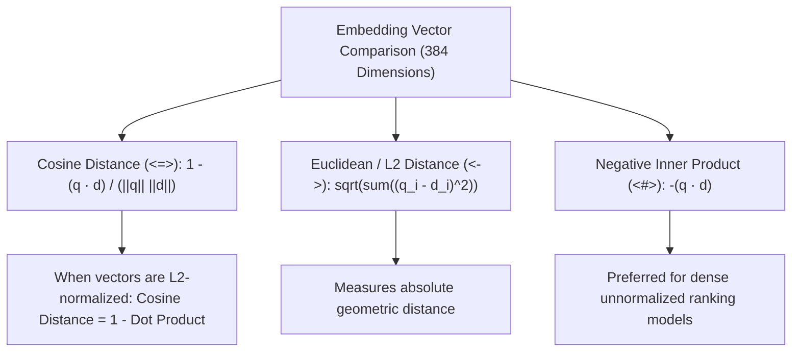
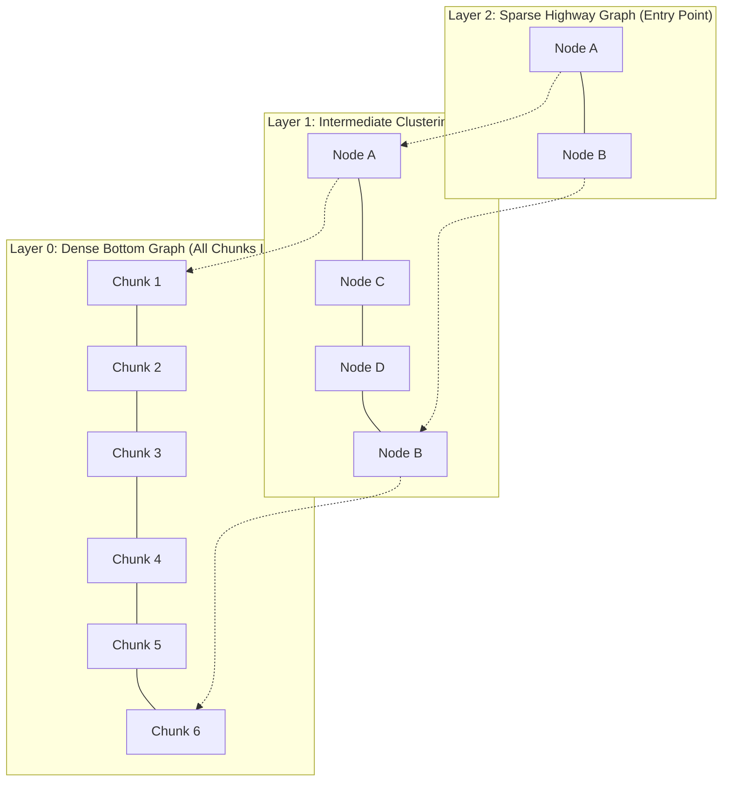
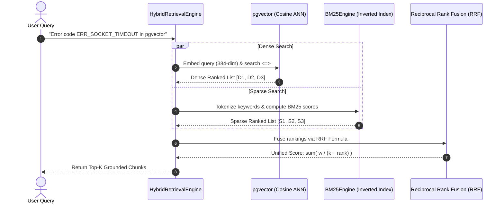

# Volume 03: RAG & Vector Database Deep Dive (pgvector & HNSW)

**Author:** Staff RAG & Vector Database Engineer & Lead TypeScript Architect  
**Core Technologies:** PostgreSQL 16 `pgvector`, HNSW Indexing, Pure TS BM25, Reciprocal Rank Fusion (RRF)

---

## 1. Vector Distance Metrics: Mathematical Comparison

In high-dimensional embeddings ($\mathbb{R}^{384}$ for `all-MiniLM-L6-v2`), distance metrics quantify semantic proximity between a query vector $q$ and document chunk vector $d$.



### Mathematical Formulations

1. **Cosine Distance (`<=>`):**
   $$D_{\text{cosine}}(q, d) = 1 - \frac{\sum_{i=1}^{n} q_i d_i}{\sqrt{\sum_{i=1}^{n} q_i^2} \sqrt{\sum_{i=1}^{n} d_i^2}}$$
   - Invariant to vector magnitude; focuses exclusively on angular orientation.
   - Recommended for textual semantic representations.

2. **Euclidean Distance (`<->`):**
   $$D_{\text{L2}}(q, d) = \sqrt{\sum_{i=1}^{n} (q_i - d_i)^2}$$

3. **Negative Inner Product (`<#>`):**
   $$D_{\text{IP}}(q, d) = - (q \cdot d) = - \sum_{i=1}^{n} q_i d_i$$

---

## 2. HNSW (Hierarchical Navigable Small World) Graph Architecture

HNSW is a multi-layer graph index where upper layers contain long-range highway edges (sparse skip-lists) and lower layers contain dense local clustering. It enables approximate nearest neighbor (ANN) search with logarithmic time complexity $O(\log N)$.



### Key pgvector Indexing Parameters

In [`backend/src/db/migrations/0001_vector_and_hnsw.sql`](file:///p:/prabhu/projects/ai_ts_fullstack_mastery/backend/src/db/migrations/0001_vector_and_hnsw.sql):
```sql
CREATE INDEX IF NOT EXISTS embeddings_hnsw_cosine_idx 
ON embeddings 
USING hnsw (embedding vector_cosine_ops) 
WITH (m = 16, ef_construction = 64);
```

- `m = 16`: The maximum number of bidirectional connections per node. Higher values improve recall at the cost of memory.
- `ef_construction = 64`: The size of the dynamic candidate list evaluated during index construction. Higher values yield a higher-quality graph.
- Runtime search control: `SET hnsw.ef_search = 40;` controls the search queue depth during query execution.

---

## 3. Hybrid Retrieval: Reciprocal Rank Fusion (RRF)

Dense vector search can occasionally miss exact keyword identifiers (e.g. error codes, product serial numbers, variable names). To solve this, our pure TypeScript hybrid engine fuses sparse lexical search (Okapi BM25) and dense semantic search (`pgvector`).



### The RRF Formula
$$RRF\_Score(d) = \sum_{m \in M} \frac{w_m}{k + r_m(d)}$$
Where $k = 60$ (smoothing constant), $r_m(d)$ is the 1-based rank in retriever $m$, and $w_m$ is the retriever weight (Dense: $0.6$, Lexical: $0.4$).
