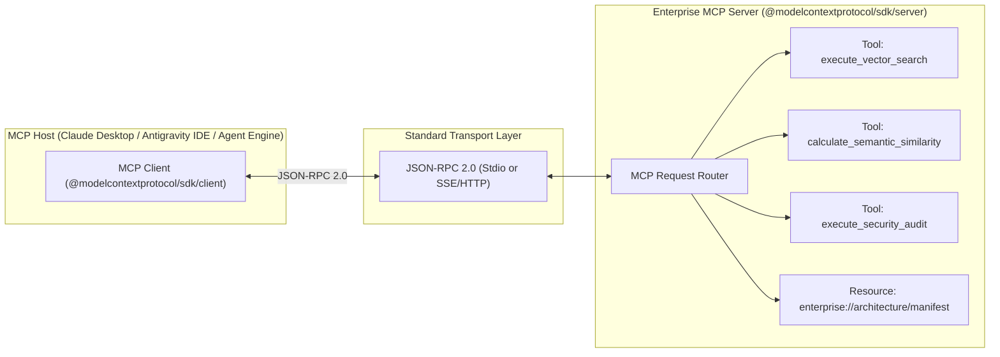
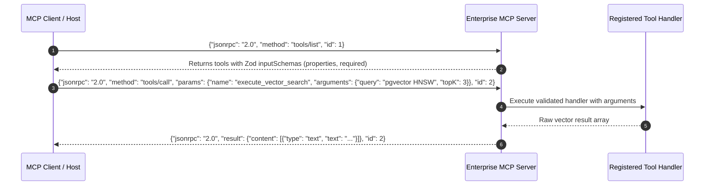

# Volume 04: Model Context Protocol (MCP) Architectural Guide

**Author:** Anthropic Model Context Protocol (MCP) Architect & Staff Systems Engineer  
**Specification Reference:** Anthropic Model Context Protocol Specification & `@modelcontextprotocol/sdk`

---

## 1. What is the Model Context Protocol?

The **Model Context Protocol (MCP)** is an open standard that allows AI models, IDEs, and autonomous agents to securely connect to external tools, data repositories, and execution environments using standard JSON-RPC 2.0 protocols over standard I/O (Stdio) or Server-Sent Events (SSE).



---

## 2. MCP Request-Response Execution Protocol



---

## 3. Tool Sandboxing & Input Schema Validation

In our TypeScript backend implementation [`backend/src/ai/mcp/enterpriseMcpServer.ts`](file:///p:/prabhu/projects/ai_ts_fullstack_mastery/backend/src/ai/mcp/enterpriseMcpServer.ts), all tool parameters are strictly validated using standard JSON Schema definitions derived from Zod.

### Exposing Tools via MCP Server
```typescript
this.server.setRequestHandler(ListToolsRequestSchema, async () => {
  return {
    tools: [
      {
        name: 'execute_vector_search',
        description: 'Performs semantic vector search over PostgreSQL pgvector embeddings.',
        inputSchema: {
          type: 'object',
          properties: {
            query: { type: 'string', description: 'Semantic query text' },
            topK: { type: 'number', description: 'Maximum results to return' },
          },
          required: ['query'],
        },
      },
    ],
  };
});
```

### Exposing Architectural Resources via URIs
MCP allows AI models to read static or dynamic enterprise resources via custom URI schemes (e.g., `enterprise://architecture/manifest`):
```typescript
this.server.setRequestHandler(ReadResourceRequestSchema, async (request) => {
  if (request.params.uri === 'enterprise://architecture/manifest') {
    return {
      contents: [
        {
          uri: request.params.uri,
          mimeType: 'application/json',
          text: JSON.stringify({
            runtime: 'Node.js 22 LTS (Strict TypeScript)',
            database: 'PostgreSQL 16 + pgvector',
            cache: 'Redis 7 Semantic Cache',
          }),
        },
      ],
    };
  }
  throw new Error(`Resource '${request.params.uri}' not found.`);
});
```
