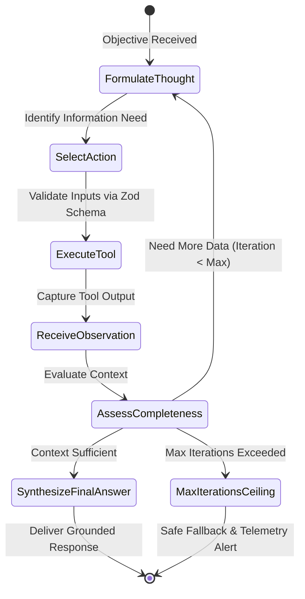
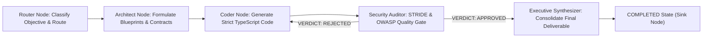

# Volume 05: Autonomous Agentic Systems & Multi-Agent Swarms

**Author:** Autonomous Agent Systems Engineer & Cognitive Architect  
**Core Technologies:** Pure TS ReAct Cognitive Loop, LangGraph-style State Machine DAGs, Zod Tool Sandboxes

---

## 1. ReAct Cognitive Reasoning Architecture

The **ReAct** (Reasoning + Acting) pattern couples structured chain-of-thought deliberations with deterministic tool invocations. The agent iterates through a bounded loop until sufficient factual observations are collected to synthesize a final grounded answer.



---

## 2. Multi-Agent Graph Orchestration (LangGraph-style DAG)

For complex enterprise engineering workflows, single-agent loops are insufficient. Our supervisor multi-agent graph coordinates specialized agents through an explicit Directed Acyclic Graph (DAG) state machine.



---

## 3. Cognitive Safety Bounds & Guardrails

To prevent infinite loops, runaway token expenditures, and excessive agency (OWASP LLM06), our ReAct engine enforces four critical architectural constraints:

1. **Iteration Hard Ceiling:** Bounded by `maxIterations` (default: 5) to guarantee deterministic termination.
2. **Execution Timeouts:** Tool invocations are capped with individual execution deadlines (3000ms).
3. **Zod Input Schema Enforcing:** Agents cannot pass arbitrary JSON or unvalidated parameters to underlying tools. Every tool schema is strictly typed with Zod:
   ```typescript
   export const VectorSearchInputSchema = z.object({
     query: z.string().min(1),
     topK: z.number().int().positive().default(3),
   });
   ```
4. **State Machine Immutability:** Agent node transitions append to an immutable execution history containing execution latencies, node names, and output digests.
