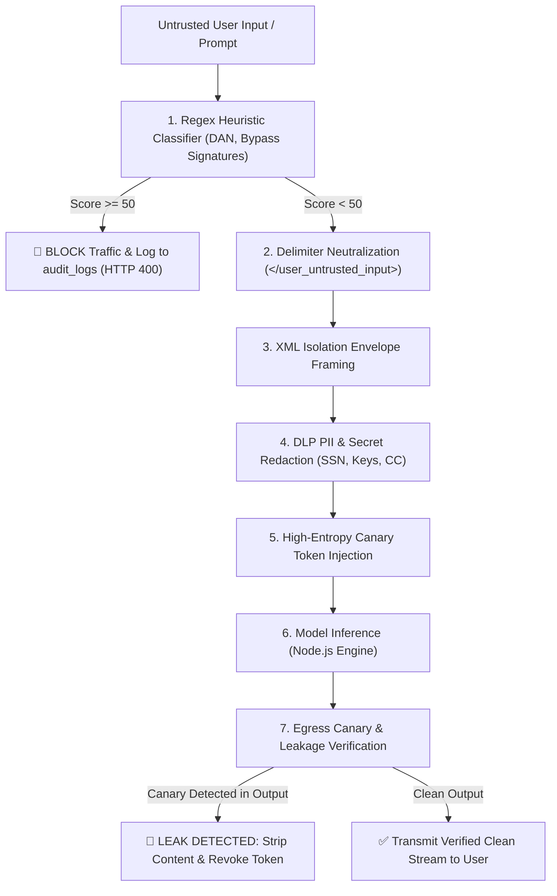
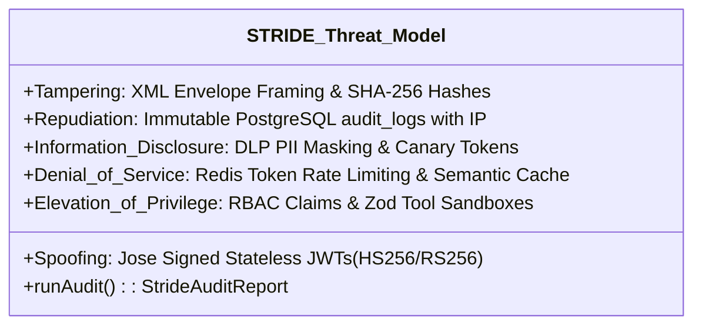

# Volume 06: Cybersecurity & AI AppSec Defense Manual

**Author:** Lead AI Application Security & OWASP Auditor  
**Reference Frameworks:** OWASP Top 10 for Large Language Models (2025/2026), STRIDE Threat Model, NIST AI RMF

---

## 1. OWASP Top 10 for LLMs Defense Architecture

---

## 2. STRIDE Threat Model for AI Microservices

---

## 3. Defense Mechanisms Implementation

### 3.1 OWASP LLM01: Prompt Injection Defense
In [`backend/src/security/promptInjectionFirewall.ts`](file:///p:/prabhu/projects/ai_ts_fullstack_mastery/backend/src/security/promptInjectionFirewall.ts):
- **XML Enveloping:** Untrusted inputs are enclosed inside `<user_untrusted_input>` tags. All closing delimiter attempts (`</user_untrusted_input>`, `<system>`) are escaped before reaching model context.
- **Canary Tokens:** A unique cryptographic token (`CANARY_<entropy>_<hmac>`) is embedded into privileged instructions. If the model echoes this token, the response is instantly aborted.

### 3.2 OWASP LLM02: Data Loss Prevention (DLP)
In [`backend/src/security/dlpMasker.ts`](file:///p:/prabhu/projects/ai_ts_fullstack_mastery/backend/src/security/dlpMasker.ts):
- Scrubbing rules neutralize SSNs (`\d{3}-\d{2}-\d{4}`), Credit Cards (Luhn/regex), Email addresses, AWS Access Keys (`AKIA...`), and OpenAI API keys (`sk-...`).
- Supports reversible mapping for authorized downstream re-hydration.

### 3.3 Password Storage: Argon2id Constant-Time Verification
In [`backend/src/security/passwordHasher.ts`](file:///p:/prabhu/projects/ai_ts_fullstack_mastery/backend/src/security/passwordHasher.ts):
- High-memory key derivation with 16-byte cryptographically secure random salts.
- Constant-time buffer verification using `crypto.timingSafeEqual` to eliminate timing side-channel attacks.
