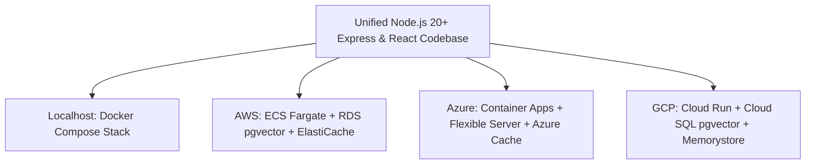
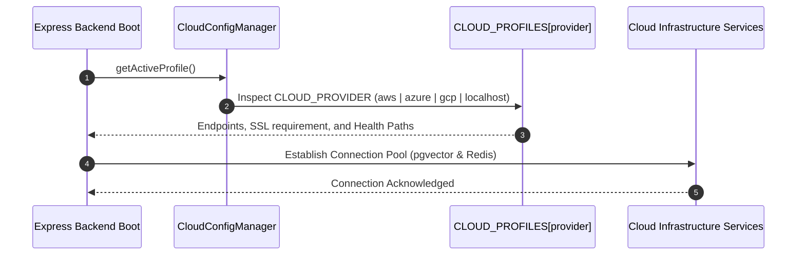

# Volume 07: Multi-Cloud Deployment Guide (AWS, Azure, GCP, Localhost)

**Author:** Principal Multi-Cloud AI Systems Architect  
**Targets:** Localhost (Docker Compose), AWS (ECS Fargate / RDS), Azure (Container Apps / Flexible Server), GCP (Cloud Run / Cloud SQL)

---

## 1. Multi-Cloud Topology Matrix

---

## 2. Dynamic Cloud Configuration Engine

In [`backend/src/config/cloudDeployConfig.ts`](file:///p:/prabhu/projects/ai_ts_fullstack_mastery/backend/src/config/cloudDeployConfig.ts), our modular `CloudConfigManager` dynamically resolves endpoints, security recommendations, and connection strings according to the `CLOUD_PROVIDER` environment variable:

---

## 3. Cloud Provider Comparison Matrix

| Operational Dimension | Localhost | Amazon Web Services (AWS) | Microsoft Azure | Google Cloud Platform (GCP) |
| :--- | :--- | :--- | :--- | :--- |
| **Compute Engine** | Docker Compose | ECS Fargate / EKS | Azure Container Apps / AKS | Cloud Run / GKE |
| **Vector Database** | `ankane/pgvector:latest` | RDS PostgreSQL 16 (`pgvector`) | Azure DB PostgreSQL Flexible Server | Cloud SQL PostgreSQL 16 (`enable_pgvector`) |
| **Cache Tier** | `redis:7-alpine` | ElastiCache for Redis (TLS) | Azure Cache for Redis (Premium) | Memorystore for Redis |
| **Secret Management** | Local `.env` | AWS Secrets Manager & KMS | Azure Key Vault & Managed Identity | Google Secret Manager |
| **Ingress & WAF** | Nginx Alpine reverse proxy | AWS ALB + AWS WAF | Application Gateway (AGIC) | Cloud Run Ingress + Cloud Armor |
| **Infrastructure-as-Code** | `docker-compose.yml` | `deployment/aws/ecs-task-definition.json` | `deployment/azure/azure-container-apps.yaml` | `deployment/gcp/cloud-run-service.yaml` |
