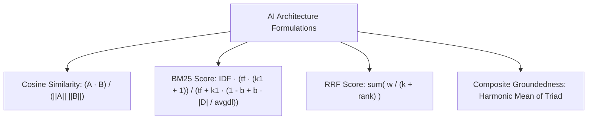
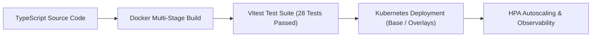

# Volume 08: Glossary, Mathematical Formulas & DevSecOps Cheat Sheets

**Author:** Lead DevSecOps & AI Systems Engineer  
**Scope:** Mathematical Formulations, CLI Cheat Sheets, and Pure TypeScript NPM Catalog

---

## 1. Quick-Reference Mathematical Formulas



### 1.1 Cosine Similarity & Vector Normalization
$$\text{CosineSim}(u, v) = \frac{\sum_{i=1}^n u_i v_i}{\sqrt{\sum_{i=1}^n u_i^2} \sqrt{\sum_{i=1}^n v_i^2}}$$
When $u$ and $v$ are L2-normalized ($\|u\|_2 = \|v\|_2 = 1$):
$$\text{CosineSim}(u, v) = u \cdot v = \sum_{i=1}^n u_i v_i$$
$$\text{CosineDistance}(u, v) = 1 - (u \cdot v)$$

### 1.2 Okapi BM25 Ranking
$$\text{BM25}(D, Q) = \sum_{i=1}^{n} \text{IDF}(q_i) \cdot \frac{f(q_i, D) \cdot (k_1 + 1)}{f(q_i, D) + k_1 \cdot \left(1 - b + b \cdot \frac{|D|}{\text{avgdl}}\right)}$$
Standard parameters: $k_1 = 1.5$, $b = 0.75$.

### 1.3 Reciprocal Rank Fusion (RRF)
$$RRF\_Score(d) = \sum_{m \in M} \frac{w_m}{k + r_m(d)}$$
Standard smoothing constant: $k = 60$.

---

## 2. DevSecOps & Container Orchestration Lifecycle



---

## 3. Pure TypeScript NPM Package Catalog

| NPM Package | Version | Purpose in Ecosystem |
| :--- | :--- | :--- |
| `@modelcontextprotocol/sdk` | `^1.6.0` | Anthropic Model Context Protocol server and client implementation |
| `@xenova/transformers` | `^2.17.2` | Native JS/WASM deep learning feature extraction & embeddings |
| `pgvector` | `^0.2.0` | PostgreSQL pgvector extension type binding and SQL converters |
| `drizzle-orm` | `^0.39.3` | Type-safe SQL schema declaration and queries |
| `ioredis` | `^5.5.0` | High-performance Redis client for semantic vector caching |
| `jose` | `^5.9.6` | Signed stateless JSON Web Tokens (JWT) and claims verification |
| `zod` | `^3.24.2` | Runtime schema validation for DTOs, tools, and prompts |
| `helmet` | `^8.0.0` | Production HTTP security headers (CSP, HSTS) |

---

## 4. Docker & Kubernetes CLI Cheat Sheet

### Docker & Docker Compose
```bash
# Build and run development stack with live hot-reloading
docker compose -f docker-compose.dev.yml up --build

# Run production multi-container stack
docker compose up -d --build

# Check health of pgvector and redis
docker compose ps
docker exec -it ai_pgvector_db psql -U postgres -d ai_enterprise_db -c "SELECT * FROM pg_extension WHERE extname = 'vector';"
docker exec -it ai_redis_cache redis-cli ping
```

### Kubernetes & Kustomize
```bash
# Deploy local overlay to Minikube/Kind
kubectl apply -k k8s/local

# Verify rollout status
kubectl rollout status deployment/backend -n ai-enterprise
kubectl rollout status statefulset/postgres -n ai-enterprise

# Inspect Horizontal Pod Autoscalers
kubectl get hpa -n ai-enterprise
```

### Helm 3
```bash
# Lint Helm chart
helm lint k8s/helm/ai-ts-fullstack

# Dry-run template rendering
helm template ai-fullstack k8s/helm/ai-ts-fullstack --values k8s/helm/ai-ts-fullstack/values.yaml

# Deploy release
helm upgrade --install ai-fullstack k8s/helm/ai-ts-fullstack -n ai-enterprise --create-namespace
```
