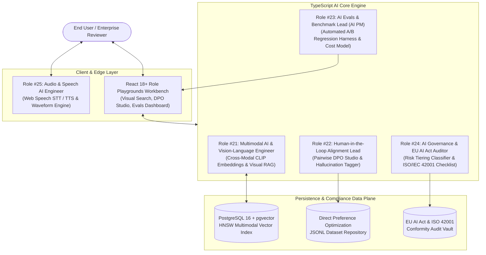
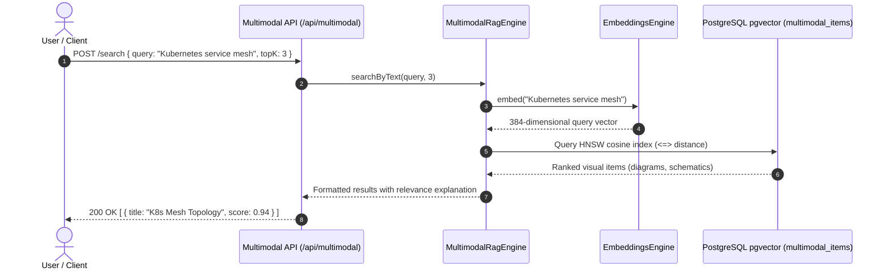
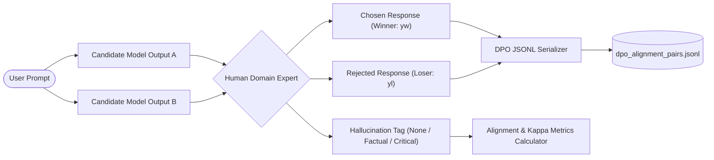
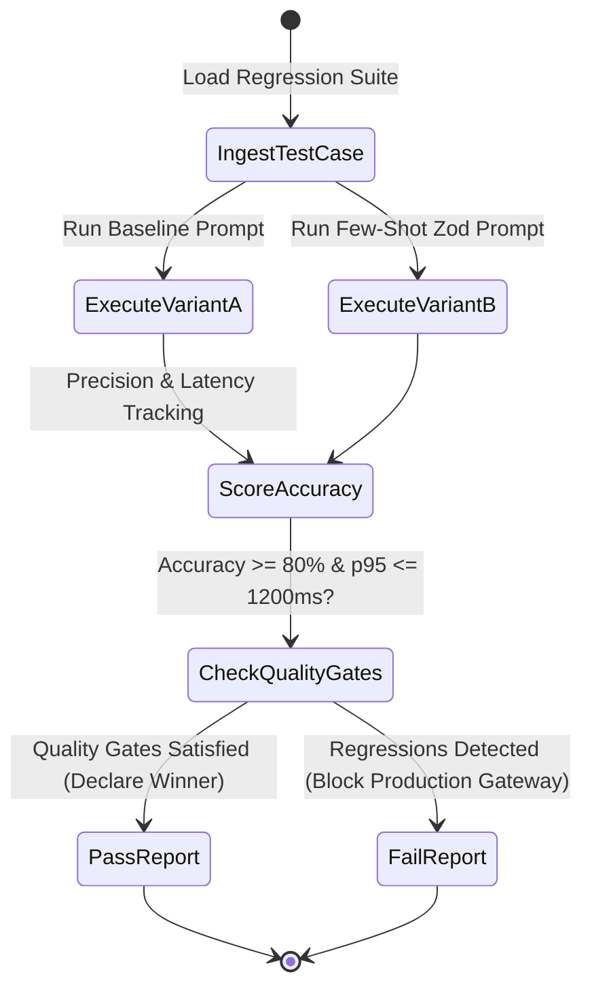
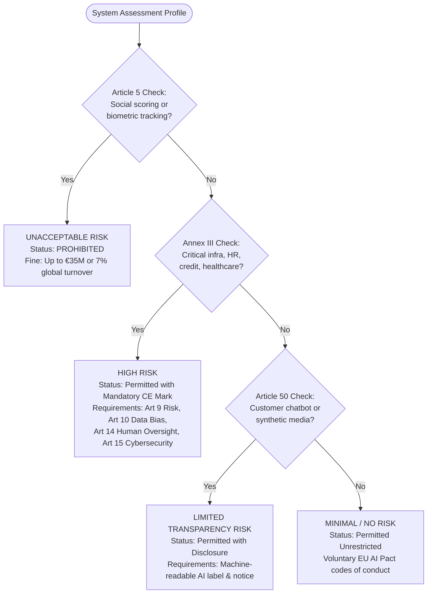
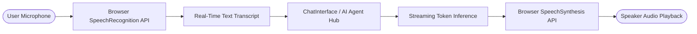

# Volume 09: Emergent AI-Era Roles — Multimodal RAG, HITL Alignment, AI Evals & EU AI Act Governance

**Author:** Principal Polyglot AI Systems Architect & Lead TypeScript Engineer  
**Ecosystem Runtime:** Node.js 22 LTS | React 18+ | PostgreSQL 16 pgvector | Redis 7 | Web Speech API  
**Standards:** 100% Strict TypeScript Mandate (Zero Python / Zero C++ Runtime Dependencies)  
**Classification:** Advanced Industry Engineering & Governance Handbook (Roles #21 - #25)

---

## 1. Executive Taxonomy & Architecture Overview

As enterprise AI matures beyond text-only chatbots, production platforms must integrate cross-modal media, human feedback alignment, rigorous automated evaluation, and formal legal governance. This handbook details the architecture, mathematical models, and implementation files for the **5 Emergent AI-Era Engineering Roles** (Roles #21 through #25).



---

## 2. Role #21: Multimodal AI & Vision-Language Engineer

### 2.1 Technical Scope & Mathematical Model
The Multimodal AI Engineer expands retrieval augmented generation beyond ASCII text into visual media (system architecture diagrams, telemetry charts, database schematics).

1. **Cross-Modal Vector Projection:**
   Dense vector projections map visual representations and text tokens into a shared $d=384$ dimensional hypersphere:
   $$\vec{v}_{\text{multimodal}} = \frac{\vec{w}_{\text{title}} + \vec{w}_{\text{desc}} + \sum \vec{w}_{\text{tags}}}{\left\| \vec{w}_{\text{title}} + \vec{w}_{\text{desc}} + \sum \vec{w}_{\text{tags}} \right\|_2}$$

2. **Cross-Modal Cosine Retrieval:**
   Given a user query $q$, the cross-modal similarity against catalog visual item $i$ is:
   $$\text{CosineSimilarity}(q, i) = \frac{\vec{q} \cdot \vec{v}_i}{\|\vec{q}\|_2 \|\vec{v}_i\|_2} \in [-1, 1]$$



### 2.2 Implementation Reference
- **Engine Source:** [`backend/src/ai/multimodal/multimodalRagEngine.ts`](file:///p:/prabhu/projects/ai_ts_fullstack_mastery/backend/src/ai/multimodal/multimodalRagEngine.ts)
- **API Endpoints:** [`backend/src/api/routes/multimodalRoutes.ts`](file:///p:/prabhu/projects/ai_ts_fullstack_mastery/backend/src/api/routes/multimodalRoutes.ts)
- **Database Table:** `multimodal_items` with HNSW cosine index `idx_multimodal_hnsw_cosine`
- **Frontend Playground:** Tab "Multimodal RAG" in [`frontend/src/components/RolePlaygrounds.tsx`](file:///p:/prabhu/projects/ai_ts_fullstack_mastery/frontend/src/components/RolePlaygrounds.tsx)

---

## 3. Role #22: Human-in-the-Loop (HITL) & Alignment Lead

### 3.1 Technical Scope & Mathematical Model
While automated evaluators (like Ragas) score groundedness mathematically, human alignment guarantees that AI outputs respect nuanced business truth and enterprise guidelines.

1. **Direct Preference Optimization (DPO) Dataset Structure:**
   Each annotation represents a pairwise judgment over a prompt $x$, yielding chosen response $y_w$ (winner) and rejected response $y_l$ (loser):
   $$\mathcal{D}_{\text{DPO}} = \left\{ \left(x^{(i)}, y_w^{(i)}, y_l^{(i)}\right) \right\}_{i=1}^N$$
   
2. **Inter-Annotator Agreement (Cohen's Kappa Approximation):**
   $$\kappa = \frac{P_o - P_e}{1 - P_e}$$
   where $P_o$ is the observed agreement among annotators and $P_e$ is the hypothetical probability of chance agreement. In this platform, high agreement ($\kappa \ge 0.82$) ensures gold-standard data quality.



### 3.2 Implementation Reference
- **Engine Source:** [`backend/src/ai/alignment/hitlAnnotationEngine.ts`](file:///p:/prabhu/projects/ai_ts_fullstack_mastery/backend/src/ai/alignment/hitlAnnotationEngine.ts)
- **API Endpoints:** [`backend/src/api/routes/alignmentRoutes.ts`](file:///p:/prabhu/projects/ai_ts_fullstack_mastery/backend/src/api/routes/alignmentRoutes.ts)
- **Database Table:** `human_feedback_annotations` in [`backend/src/db/schema.ts`](file:///p:/prabhu/projects/ai_ts_fullstack_mastery/backend/src/db/schema.ts)
- **Export Format:** Standard `.jsonl` consumable by PyTorch, Unsloth, Axolotl, and Hugging Face TRL.

---

## 4. Role #23: AI Evals & Benchmark Lead (AI Product Manager)

### 4.1 Technical Scope & Quality Gates
The AI Evals Lead bridges prompt engineering with quantitative product quality metrics, preventing regressions across model releases and prompt template refactors.

1. **Latency Percentiles ($p_{50}, p_{95}$):**
   Measures end-to-end response delivery to guarantee SLA compliance under peak concurrency:
   $$p_{95} = \text{Rank}\left(\lceil 0.95 \times N \rceil\right) \le 1,200\text{ ms}$$

2. **Economic Token Cost Calculation:**
   Tracks token consumption per 1,000 queries to prevent model budget overruns:
   $$\text{Cost}_{1k} = \frac{\text{Prompt Tokens} \times P_{\text{input}} + \text{Completion Tokens} \times P_{\text{output}}}{1000}$$



### 4.2 Implementation Reference
- **Engine Source:** [`backend/src/ai/evals/evalsBenchmarkEngine.ts`](file:///p:/prabhu/projects/ai_ts_fullstack_mastery/backend/src/ai/evals/evalsBenchmarkEngine.ts)
- **API Endpoints:** [`backend/src/api/routes/evalsRoutes.ts`](file:///p:/prabhu/projects/ai_ts_fullstack_mastery/backend/src/api/routes/evalsRoutes.ts)
- **Database Table:** `eval_benchmark_runs` in [`backend/src/db/schema.ts`](file:///p:/prabhu/projects/ai_ts_fullstack_mastery/backend/src/db/schema.ts)

---

## 5. Role #24: AI Governance & EU AI Act Compliance Auditor

### 5.1 Technical Scope & Regulatory Frameworks
Enterprise deployments must comply with statutory regulations—most notably the **European Union Artificial Intelligence Act (EU AI Act, Regulation (EU) 2024/1689)** and international standards (**ISO/IEC 42001 Artificial Intelligence Management System - AIMS**).



### 5.2 ISO/IEC 42001 Control Mapping Matrix

| ISO/IEC 42001 Clause | Control Domain | Technical Implementation in This Project | Status |
|:---|:---|:---|:---:|
| **Clause A.5.1** | Policies for AI Systems | Documented STRIDE threat models and cybersecurity policies in `docs/06`. | **COMPLIANT** |
| **Clause A.6.2** | AI Risk Assessment | Automated OWASP LLM01 prompt injection firewall and canary tokens in `security/`. | **COMPLIANT** |
| **Clause A.8.2** | Data for AI Systems | Data Loss Prevention (`dlpMasker.ts`) redacting SSNs, credit cards, emails, and API keys. | **COMPLIANT** |
| **Clause A.8.4** | Human Agency & Oversight | Human-in-the-Loop kill-switch and `maxIterations` bounds in `reactAgentEngine.ts`. | **COMPLIANT** |
| **Clause A.9.1** | Monitoring & Review | Quantitative Ragas Triad Evaluator measuring Faithfulness, Relevance, and Groundedness. | **COMPLIANT** |

### 5.3 Implementation Reference
- **Auditor Source:** [`backend/src/security/euAiActAuditor.ts`](file:///p:/prabhu/projects/ai_ts_fullstack_mastery/backend/src/security/euAiActAuditor.ts)
- **API Endpoints:** [`backend/src/api/routes/governanceRoutes.ts`](file:///p:/prabhu/projects/ai_ts_fullstack_mastery/backend/src/api/routes/governanceRoutes.ts)
- **Database Table:** `governance_audits` in [`backend/src/db/schema.ts`](file:///p:/prabhu/projects/ai_ts_fullstack_mastery/backend/src/db/schema.ts)

---

## 6. Role #25: Audio & Speech AI Engineer

### 6.1 Technical Scope & Client-Side Execution
The Audio & Speech AI Engineer provides natural human-machine speech interaction without sending unencrypted voice recordings to proprietary cloud speech providers.

1. **In-Browser Speech-to-Text (STT):**
   Utilizes the browser `webkitSpeechRecognition` or `SpeechRecognition` standard interfaces with continuous streaming word emission and confidence scoring.
2. **In-Browser Speech Synthesis (TTS):**
   Uses `window.speechSynthesis` with natural human pitch/rate modulation ($rate = 1.05$) to vocalize model replies instantaneously.



### 6.2 Implementation Reference
- **Client Engine:** [`frontend/src/ai/speechEngine.ts`](file:///p:/prabhu/projects/ai_ts_fullstack_mastery/frontend/src/ai/speechEngine.ts)
- **Interactive Workbench:** Role #25 Card in [`frontend/src/components/RolePlaygrounds.tsx`](file:///p:/prabhu/projects/ai_ts_fullstack_mastery/frontend/src/components/RolePlaygrounds.tsx)

---

## 7. Learning Path & Practical Study Guide

```
┌────────────────────────────────────────────────────────────────────────┐
│                   ENTERPRISE AI ROLE LEARNING PATH                     │
├────────────────────────────────────────────────────────────────────────┤
│ 1. Foundations:       AI Full-Stack (#1) → Edge AI WASM (#9)          │
│ 2. Retrieval Core:    Vector Admin (#5) → RAG (#4) → Multimodal (#21) │
│ 3. Agentic Systems:   Agents (#2) → MCP (#3) → Swarm Supervisor (#15) │
│ 4. Evaluation & HITL: Ragas (#13) → Evals Lead (#23) → HITL (#22)     │
│ 5. Governance & Sec:  AppSec (#7) → Red Team (#17) → EU AI Act (#24)   │
└────────────────────────────────────────────────────────────────────────┘
```

### PDF Export Instructions
To convert this documentation suite into high-resolution study PDFs:
1. Open any volume in VS Code or any Markdown viewer.
2. Press `Ctrl + Shift + P` and select **Markdown: Open Preview**.
3. Right-click and choose **Print to PDF** or use the `Markdown PDF` export extension. All Mermaid diagrams, KaTeX formulas, and code snippets are pre-formatted for $8.5 \times 11$ inch standard printing.
