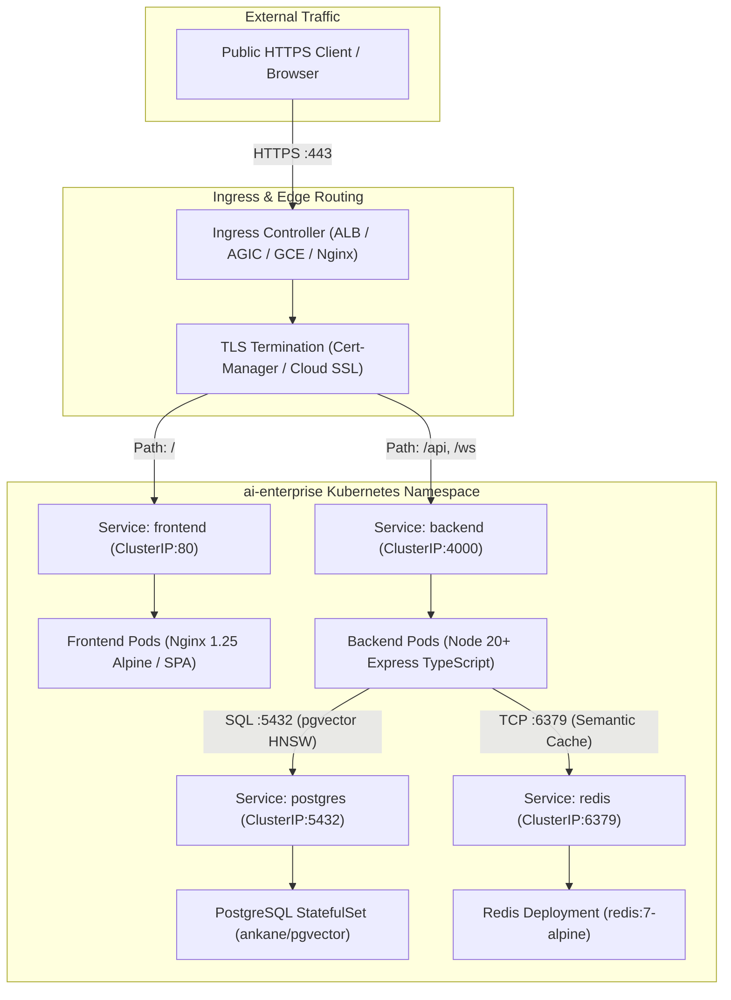
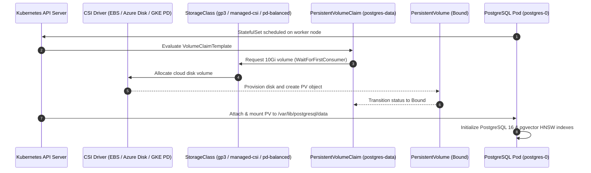
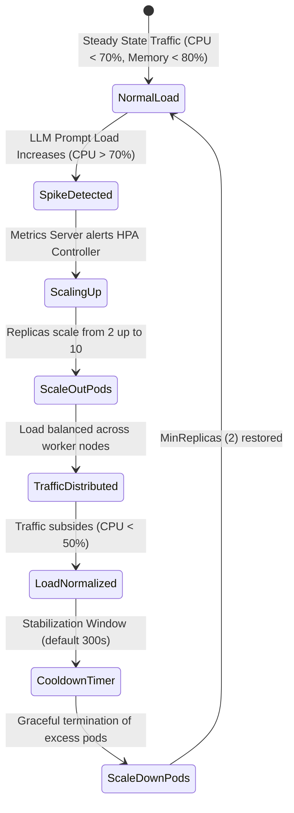

# Volume 06: Kubernetes Architecture Diagrams & Visual Workflows

**Author:** Principal Cloud-Native Infrastructure Architect & Staff DevSecOps Engineer  
**Scope:** Production Pod Networking, Ingress Traffic Routing, Stateful Storage Lifecycles, and Autoscaling Loops

---

## 1. End-to-End Ingress Traffic Routing & Pod Networking

---

## 2. Stateful Storage Lifecycle (pgvector Persistence)

---

## 3. Horizontal Pod Autoscaler (HPA) Metrics & Scaling Loop

---

## 4. Multi-Cloud Ingress Architecture Comparison

| Cloud Provider | Ingress Controller | Annotation Class | Target Type | TLS Certificate Provider |
| :--- | :--- | :--- | :--- | :--- |
| **Localhost** | Ingress-Nginx | `kubernetes.io/ingress.class: nginx` | Pod IP / HostPort | Local self-signed / Cert-Manager |
| **AWS EKS** | AWS Load Balancer Controller | `alb.ingress.kubernetes.io/scheme: internet-facing` | IP mode (`awsvpc`) | AWS Certificate Manager (ACM) |
| **Azure AKS** | Application Gateway (AGIC) | `kubernetes.io/ingress.class: azure/application-gateway` | CNI Pod IP | Azure Key Vault / App Gateway SSL |
| **GCP GKE** | GCE Ingress Controller | `kubernetes.io/ingress.class: gce` | VPC-native NEG | Google Managed Certificate (`networking.gke.io`) |
